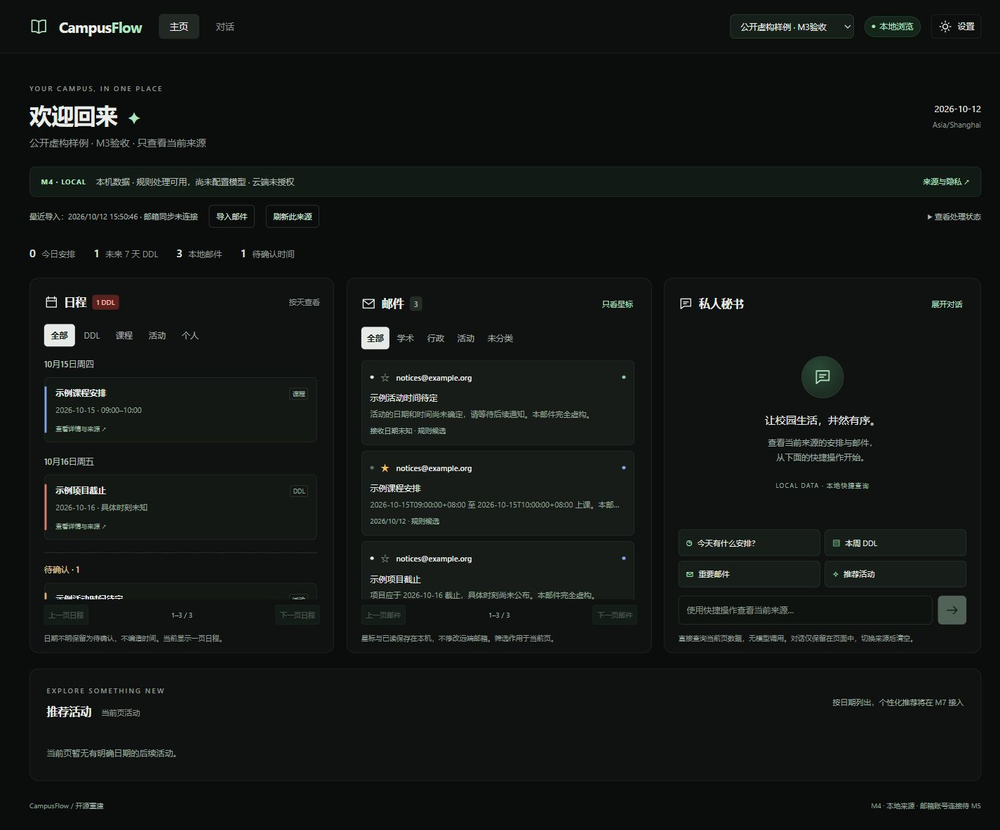

# Campus Flow

Local-first campus email assistant, rebuilt as an open-source project.

[Repository & ongoing share link](https://github.com/jianingliu25/campus-flow) ·
[Automated checks](https://github.com/jianingliu25/campus-flow/actions/workflows/checks.yml)

**Current status: M4 source-aware dashboard, conversation view and privacy settings.**
This is an early public checkpoint. Follow `main` for M5–M9 updates at the same repository URL.
No account, API key, model weights, or real email is required. Choose fictional
preview or one of your local sources. The three-panel dashboard
shows only that source. Local shortcuts read the visible page without model calls;
file imports still require explicit selection and confirmation.
SQL storage, local sessions, source isolation and processing gates are implemented.
EML/MBOX import and an explicit local rule fallback work today. IMAP, MCP,
actual model/index integration and SMOA are upcoming milestones.



## Quickstart

Prerequisites: Python 3.11+ and Node.js 22.12+ with npm. Initial dependency installation
requires network access. After setup, the fictional demo runs offline.

From this directory, on Windows PowerShell, macOS or Linux:

```text
python scripts/manage.py setup
python scripts/manage.py demo
```

Open [the local preview](http://127.0.0.1:8000). Stop with Ctrl+C.
On systems where Python is named `python3`, replace `python` with `python3`.
Use `--port 8001` if port 8000 is occupied. `--no-build` reuses an existing build.
The server listens only on loopback, and serves the frontend and preview API together.

## What works today

- Dark three-panel preview and bottom activity section based on the course UI.
- 30 entirely fictional emails: 10 academic, 10 administrative, 10 activity notices.
- Category filters, source email details and four local shortcuts for the selected source.
- 26 annotated event records, including superseded and unknown-time cases.
- 20 development questions and exported JSON schemas. No performance claims yet.
- Dependency lockfiles and a cross-platform setup/build/test entry point.
- M2: 12 application tables, migrations 0001–0002, per-source policies and local sessions.
- M2: source-bound API reads, gated compatible providers, local embedding interface,
  and a leased recoverable indexing outbox.

- M3: text-only EML/MBOX previews, selection before saving, deduplication, timezone-aware
  rule candidates and source-linked reprocessing. [Usage and limits](docs/milestones/M3.md).
- M4: source-aware three-panel UI, pending events, persistent local stars/read flags,
  paginated reads, full conversation view, mobile panel tabs and source/privacy settings.
  [Usage and acceptance](docs/milestones/M4.md).

Activity lists show dated events from the current page, not personalized recommendations.
Local-source stars/read flags persist in SQLite. Fictional-source stars reset on reload.
Conversations stay in page memory and clear on source change; shortcuts use current stars.
There is no calendar write, account connection or vector retrieval. Model reprocessing
is optional, explicitly requested and provider-gated; real inference has not been validated.

## Validation

```text
python scripts/manage.py validate
python scripts/manage.py test
```

`validate` checks typed fixture contracts and exports JSON schemas. `test` runs
the backend checks and frontend typecheck/build. Browser checks are documented
in [M1](docs/milestones/M1.md), [M2](docs/milestones/M2.md),
[M3](docs/milestones/M3.md) and [M4](docs/milestones/M4.md).

```text
python scripts/manage.py migrate
python scripts/manage.py db-status
```

The local database is created and migrated at server startup; these commands also
support explicit migration/status inspection. `db-status` ensures the current
schema before reporting status. Runtime data stays outside the source repository.

## Data and privacy

Fictional and local sources are displayed separately. The import panel can save user-selected
mail into a private local SQL database, protected by an ephemeral HttpOnly/SameSite session.
Raw upload files are not saved; normalized body retention follows the source policy.
No account is connected or synced. No source is created or activated automatically. Keep the app on loopback.

Processing goes through the gate: cloud requires both global enablement and
per-source provider-specific consent. M2 calls are tested with mock transports;
no actual provider was contacted. No worker or model download starts automatically.
See [privacy boundaries](docs/privacy.md).

The evaluation corpus is frozen at `2026-10-12T09:00:00+08:00`. The preview shifts
fictional dates to today in Asia/Shanghai without modifying the public files.
To freeze the preview, set `DEMO_REFERENCE_DATE=2026-10-12` in `.env`.
Copy `.env.example` only if you want to change settings; setup does not require it.

## Development

Use the project virtual environment. For live frontend development, start the
API in one terminal and Vite in another:

```text
python scripts/manage.py demo --no-build
```

```text
cd frontend
npm run dev
```

Vite proxies `/api` to loopback port 8000; keep that API port for this workflow.
Installation uses `backend/constraints.txt` and `frontend/package-lock.json`.
`backend/requirements.in` records the allowable ranges for future lock updates.
Re-generate the original fictional corpus with `python scripts/generate_fixtures.py`;
this intentionally replaces only the tracked fixtures and development QA data.

## Roadmap and rights

M1 scaffold (done) → M2 storage/isolation/security (done) → M3 local import (done) → M4 full UI (done) →
M5 IMAP/MCP → M6 SMOA → M7 memory/recommendations → M8 evaluation → M9 GitHub release.

Newly written reconstruction code and original fictional fixtures are available
under the [MIT License](LICENSE). Legacy course files, team code, reports and
original reference images are not included. Screenshots show this reconstruction
with fictional data. Third-party packages and future model weights retain their
own licenses. See [publication scope](docs/publication.md).

---

## 中文说明

Campus Flow 是本地优先的校园邮件与日程助理重建项目。当前已完成 **M4 三栏界面联调**：顶部切换来源，三栏显示此来源的邮件与日程；星标/已读本地持久保存；支持完整对话页、手机面板切换及来源/隐私设置。M3 的 EML/MBOX 导入已接入主页。已具备
数据库迁移、来源隔离、本机会话、防跨站检查、处理授权和可恢复的索引任务队列。
支持深色三栏、分类筛选、来源邮件回跳及四个本地快捷操作；自由问答和个性化推荐仍待后续接入。

按上方两条命令安装并启动，打开本地预览即可；无需邮箱账号或 API Key。
安装依赖需要网络，安装后演示无需联网，也不下载模型。原课程文件完整保留在项目目录外。

首次打开选择“体验虚构演示”或“导入我的本地邮件”。在设置中创建来源后，点击“导入邮件”选择文件；也可下载虚构样例先体验。
真实账号连接、MCP、SMOA、历史数据清理和个性化推荐将在后续阶段逐步实现。
演示中的“预置回答”不代表模型推理，原课程成绩也不代表此重建版的评估结果。
