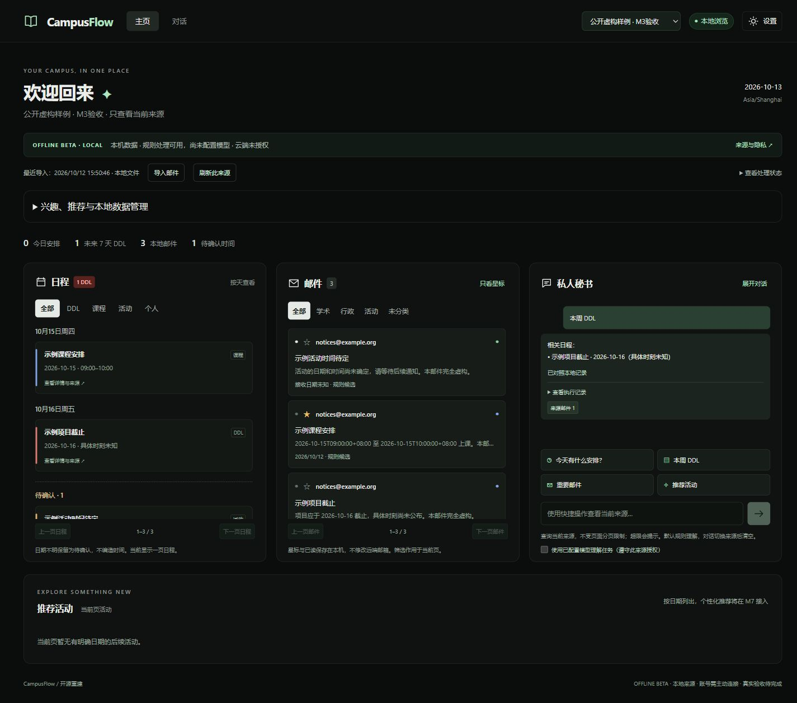

# Campus Flow

Local-first campus email assistant, rebuilt as an open-source project.

[Repository & ongoing share link](https://github.com/jianingliu25/campus-flow) ·
[Automated checks](https://github.com/jianingliu25/campus-flow/actions/workflows/checks.yml)

**Current status: v0.9.0 offline beta (M1–M9 reconstruction engineering).**
Choose a fictional demo or explicitly configure a local-file, IMAP or HTTP MCP source.
Mail parsing, conservative rule extraction, source-wide six-stage assistant queries,
manual calendar corrections, activity membership, interests, local search and data
management work without a model. All public examples are fictional.

IMAP and the documented MCP contract are implemented with read-only operations;
actual account acceptance has not been performed. The researched Gmail/Outlook MCP
services need operator setup and vendor schema adaptation: see [connectors](docs/connectors.md).
Optional model routing requires an explicitly configured provider and per-source
cloud consent. Learned semantic quality and optional FAISS runtime remain unvalidated.
This release is not a claim of production readiness or paper-result reproduction.

[Offline evaluation](docs/milestones/M8.md): 39/40 authored intent questions pass;
rule mail classification is 70% on development data and exact extraction field
F1 is 0.3648. Failures and limitations are published, not replaced with demo gold.



## Quickstart

Prerequisites: Python 3.11+ and Node.js 22.12+ with npm. Initial dependency installation
requires network access. After setup, the fictional demo runs offline.

From this directory, on Windows PowerShell, macOS or Linux:

```text
python scripts/manage.py setup
python scripts/manage.py demo
```

Open [the local preview](http://127.0.0.1:8000). Stop with Ctrl+C.
On systems where Python is named `python3`, replace `python` with `python3`.
Use `--port 8001` if port 8000 is occupied. `--no-build` reuses an existing build.
The server listens only on loopback, and serves the frontend and preview API together.

## What works today

- Dark three-panel preview and bottom activity section based on the course UI.
- 30 entirely fictional emails: 10 academic, 10 administrative, 10 activity notices.
- Category filters, source email details and four local shortcuts for the selected source.
- 26 annotated event records, including superseded and unknown-time cases.
- 20 development questions, 40 frozen intent questions, exported schemas and reproducible offline reports.
- Dependency lockfiles and a cross-platform setup/build/test entry point.
- 14 application tables, migrations 0001–0003, per-source policies and local sessions.
- M2: source-bound API reads, gated compatible providers, local embedding interface,
  and a leased recoverable indexing outbox.

- M3: text-only EML/MBOX previews, selection before saving, deduplication, timezone-aware
  rule candidates and source-linked reprocessing. [Usage and limits](docs/milestones/M3.md).
- M4: source-aware three-panel UI, pending events, persistent local stars/read flags,
  paginated reads, full conversation view, mobile panel tabs and source/privacy settings.
  [Usage and acceptance](docs/milestones/M4.md).

The bottom activity list shows the current page. The expandable personal tools query source-wide recommendations with explicit interests and disclosed keyword/time ranking.
Local-source stars/read flags persist in SQLite. Fictional-source stars reset on reload.
Conversations stay in page memory and clear on source change; shortcuts use current stars.
Local calendar membership and corrections persist. Connector sync and local lexical vector retrieval are explicit actions. Model reprocessing
is optional, explicitly requested and provider-gated; real inference has not been validated.

## Validation

```text
python scripts/manage.py validate
python scripts/manage.py test
```

`validate` checks typed fixture contracts and exports JSON schemas. `test` runs
the backend checks and frontend typecheck/build. Browser checks are documented
in [M1](docs/milestones/M1.md), [M2](docs/milestones/M2.md),
[M3](docs/milestones/M3.md) and [M4](docs/milestones/M4.md).

```text
python scripts/manage.py migrate
python scripts/manage.py db-status
```

The local database is created and migrated at server startup; these commands also
support explicit migration/status inspection. `db-status` ensures the current
schema before reporting status. Runtime data stays outside the source repository.

## Data and privacy

Fictional and local sources are displayed separately. The import panel can save user-selected
mail into a private local SQL database, protected by an ephemeral HttpOnly/SameSite session.
Raw upload files are not saved; normalized body retention follows the source policy.
No account connects or syncs automatically. No source is created or activated automatically. Keep the app on loopback.

Processing goes through the gate: cloud requires both global enablement and
per-source provider-specific consent. M2 calls are tested with mock transports;
no actual provider was contacted. No worker or model download starts automatically.
See [privacy boundaries](docs/privacy.md).

The evaluation corpus is frozen at `2026-10-12T09:00:00+08:00`. The preview shifts
fictional dates to today in Asia/Shanghai without modifying the public files.
To freeze the preview, set `DEMO_REFERENCE_DATE=2026-10-12` in `.env`.
Copy `.env.example` only if you want to change settings; setup does not require it.

## Development

Use the project virtual environment. For live frontend development, start the
API in one terminal and Vite in another:

```text
python scripts/manage.py demo --no-build
```

```text
cd frontend
npm run dev
```

Vite proxies `/api` to loopback port 8000; keep that API port for this workflow.
Installation uses `backend/constraints.txt` and `frontend/package-lock.json`.
`backend/requirements.in` records the allowable ranges for future lock updates.
Re-generate the original fictional corpus with `python scripts/generate_fixtures.py`;
this intentionally replaces only the tracked fixtures and development QA data.

## Roadmap and rights

M1 scaffold (done) → M2 storage/isolation/security (done) → M3 local import (done) → M4 full UI (done) →
M5 IMAP/MCP (implemented, live acceptance pending) → M6 SMOA (offline tested) → M7 memory/recommendations (keyword baseline) → M8 evaluation (published) → M9 offline beta release.

Newly written reconstruction code and original fictional fixtures are available
under the [MIT License](LICENSE). Legacy course files, team code, reports and
original reference images are not included. Screenshots show this reconstruction
with fictional data. Third-party packages and future model weights retain their
own licenses. See [publication scope](docs/publication.md).

---

## 中文说明

Campus Flow 是本地优先的校园邮件与日程助理重建项目。当前发布 **v0.9.0 离线测试版**：支持本地邮件导入、显式 IMAP/MCP 配置与同步、六阶段问答执行、证据核对、手工日程修改、活动加入、兴趣、关键词推荐及本机数据管理。公开数据与截图均为虚构内容。

已完成工程实现和离线测试；真实邮箱、第三方 MCP 字段适配、实际模型效果及语义推荐仍需专项验收。公开报告包含失败题目和提取不足，不将演示标注答案作为模型效果。

按上方两条命令安装并启动，打开本地预览即可；无需邮箱账号或 API Key。
安装依赖需要网络，安装后演示无需联网，也不下载模型。原课程文件完整保留在项目目录外。

首次打开选择“体验虚构演示”或“导入我的本地邮件”。在设置中创建来源后，点击“导入邮件”选择文件；也可下载虚构样例先体验。
真实账号连接、MCP、SMOA、历史数据清理和个性化推荐将在后续阶段逐步实现。
演示中的“预置回答”不代表模型推理，原课程成绩也不代表此重建版的评估结果。

## Offline beta acceptance

- `python scripts/manage.py test`: backend regressions plus frontend type checking/build.
- `python scripts/manage.py evaluate`: reproduce the committed frozen offline report.
- `python scripts/manage.py mcp-demo`: operator-started fictional-only MCP service.
- [M5 connector implementation](docs/milestones/M5.md), [M6 agent](docs/milestones/M6.md),
  [M7 personal data and search](docs/milestones/M7.md), [M8 evaluation](docs/milestones/M8.md).
- Data management exports private JSON to this computer. Delete preview includes manual
  edits; export first if needed. Deletion does not delete upstream mail or backups.
- Cloud contact masking is best-effort. It does not anonymize names, subjects or context;
  consent is still required. The default configuration does not call cloud models.

The repository URL stays stable for subsequent changes. The immutable M2 preview
release remains available separately. No original course reports, team code, reference
image, model weights or private runtime database is included in this reconstruction.
